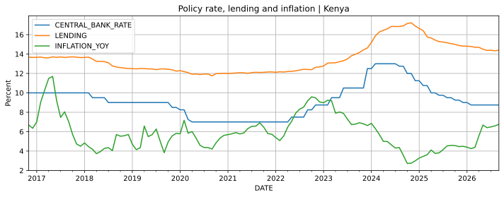
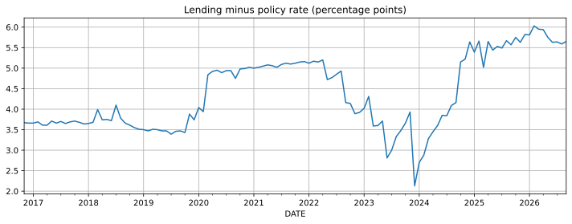
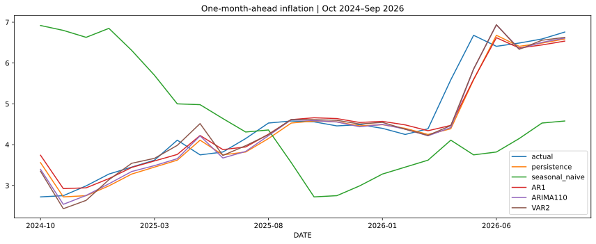

<div align="center">

# Monetary Policy Transmission in Kenya

### Interest-rate dynamics and inflation forecasting | 2016–2026

**Samuel Ndungu Njoroge** · Independent empirical research working paper


[](https://github.com/samuel6183/kenya-monetary-policy-analysis/actions/workflows/audited-research.yml)

**[Download the complete research paper (PDF)](RESEARCH_PAPER.pdf)** · **[Read online](RESEARCH_PAPER.md)** · **[Explore the executed notebook](notebooks/Research_Analysis.ipynb)** · **[Canonical dataset](data/processed/kenya_monetary_policy_audited.csv)**

[](https://colab.research.google.com/github/samuel6183/kenya-monetary-policy-analysis/blob/main/notebooks/Research_Analysis.ipynb)

</div>

## Abstract

This study investigates short-run monetary policy transmission and inflation prediction in Kenya using official CBK and KNBS data for 119 consecutive months from November 2016 to September 2026. It integrates source reconciliation, HAC dynamic regressions, stationarity tests, reduced-form VAR diagnostics and a five-model chronological forecasting evaluation.

A one-percentage-point lagged change in the Central Bank Rate (CBR) is associated with a 0.178 percentage-point change in commercial lending rates, conditional on the included lagged variables. However, the lending regression has residual autocorrelation and the VAR fails residual whiteness and normality tests. Forecast rankings are metric-dependent, and no causal claim or structural shock identification is made.

## Key empirical findings

| Research result | Estimate |
|---|---:|
| Observations | 119 months |
| Economic indicators | 14 |
| Data completeness | 95.56% |
| Lagged CBR coefficient in lending-change regression | 0.1778 |
| HAC 95% confidence interval | [0.1120, 0.2436] |
| Lending regression R² | 0.4885 |
| VAR residual whiteness p-value | 0.000531 |
| Forecast evaluation | 24 months |

## Historical monetary policy and lending dynamics



*Figure 1. Monthly national interest rates and year-on-year inflation, sourced from the canonical CBK/KNBS dataset.*

The chart illustrates policy cycles and lending-rate adjustment. It does not identify exogenous policy shocks.



*Figure 2. Weighted commercial lending rate less the CBR, percentage points.*

## Forecast performance

One-month-ahead expanding-window evaluation, October 2024–September 2026. Errors in percentage points.

| Model | MAE | RMSE |
|---|---:|---:|
| VAR(2) | 0.2704 | **0.3940** |
| ARIMA(1,1,0) | 0.2832 | 0.3945 |
| AR(1) | **0.2692** | 0.4199 |
| Persistence | 0.2858 | 0.4255 |
| Seasonal naive | 1.9171 | 2.2325 |



*Figure 3. Actual and predicted inflation in the 24-month holdout.*

The differences between leading models are small. The VAR is a separate fixed forecast specification from the BIC-selected VAR(1) diagnostic model. No statistically established superiority is claimed.

## Read the research in order

The **[PDF paper](RESEARCH_PAPER.pdf)** and **[online paper](RESEARCH_PAPER.md)** contain the complete narrative, results, integrated figures, references and reproducibility appendix. The **[executed Python notebook](notebooks/Research_Analysis.ipynb)** presents the original analytical code in seven sequential, explained stages, from integrity checks through forecasting, with saved tables and charts. The **[successful empirical workflow](https://github.com/samuel6183/kenya-monetary-policy-analysis/actions/runs/45920954623)** generated ten figures and full statistical tables.

## Data integrity and limitations

- Source-reconciled official data, 119 unique months and no imputation; 74 numeric gaps remain confined to three secondary rate series.
- CPI base periods are retained separately; no fabricated linking or cross-base comparison.
- Lending regression residual autocorrelation and VAR diagnostic failures are explicitly reported. The inflation regression does not reject the Ljung–Box test at 5% at six and twelve lags, although the twelve-lag result is borderline.
- Estimates are retrospective, associative and not causal. No independent external audit or institutional endorsement is claimed.
- National macroeconomic indicators provide background for agricultural finance and household purchasing power research; sector-specific effects require additional data.

[Data audit report](docs/data-audit-2026-11-27.md) · [CPI provenance](data/processed/cpi_source_manifest.csv) · [Detailed empirical results](docs/empirical-results-2026-11-27.md)

## Reproduce the research

```bash
git clone https://github.com/samuel6183/kenya-monetary-policy-analysis.git
cd kenya-monetary-policy-analysis
# Python 3.11 environment
pip install numpy==1.26.4 pandas==2.2.3 matplotlib==3.10.0 scipy==1.15.2 statsmodels==0.14.6
python -m src.audit_dataset
python -m src.research
```

The dataset checksum is verified before estimation. The code regenerates all ten figures and statistical tables. Earlier preliminary two-series results are superseded.

<details>
<summary>Technical repository structure</summary>

```text
RESEARCH_PAPER.pdf      Downloadable academic working paper
RESEARCH_PAPER.md       Online version with all integrated figures
notebooks/              Sequential reproduction notebook
data/processed/         Canonical dataset and source manifest
data/raw/               Source observations and collection inputs
src/                    Collection, audit and analysis code
outputs/audited/        Figures and statistical tables
docs/                   Audit trail and research notes
tests/                  Automated checks
.github/workflows/      Reproducibility and publication workflows
```

</details>

**Researcher:** [GitHub](https://github.com/samuel6183) · [LinkedIn](https://www.linkedin.com/in/samuel-ndungu-6800b8194/)

*Independent working paper, not peer reviewed, not an ILRI study. AI assistance was used in organizing and implementing the research. Review all results before academic submission.*
