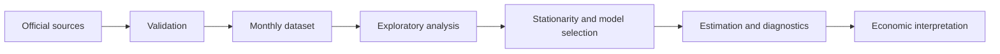

<div align="center">

# Kenya Monetary Policy Analysis

### Applied Econometrics & Macroeconomic Intelligence

    

**Investigating monetary policy transmission in Kenya using monthly macroeconomic and financial data.**

[Analysis scaffold](src/analysis.py) · [Data directories](data/) · [CivicLens Africa](https://github.com/samuel6183/CivicLens-Africa)

</div>

---

## What this project investigates

The research examines how changes in the Central Bank Rate, Treasury bill yields, commercial lending rates and inflation interact over time.

> How do monetary policy adjustments relate to commercial lending costs and inflation? What role do short-term government securities play in the transmission mechanism?

**Target study period:** November 2016 – October 2026, subject to verified data availability.

## Research workstreams

| Workstream | Research objective |
| :--- | :--- |
| Monetary policy | Examine historical movements in policy rates and liquidity conditions |
| Banking transmission | Analyse the relationship between the CBR and commercial lending rates |
| Inflation | Investigate the relationship between monetary policy and consumer prices |
| Government securities | Examine interactions between Treasury bill yields and monetary policy |
| Econometric modelling | Evaluate time-series properties, estimate relationships and conduct diagnostic tests |

## Planned dataset

| Variable | Intended source | Frequency |
| :--- | :--- | :--- |
| Central Bank Rate | [CBK](https://www.centralbank.go.ke/) | Monthly |
| Commercial lending rates | CBK | Monthly |
| Interbank rate | CBK | Monthly |
| 91-, 182- and 364-day Treasury bill yields | CBK | Monthly |
| Consumer price index and inflation | [KNBS](https://www.knbs.or.ke/) | Monthly |

World Bank and IMF data may supplement the analysis where definitions and frequencies are compatible.

## Analytical methodology



Planned techniques include descriptive statistics, time-series plots, stationarity testing, regression and appropriate dynamic econometric models. Model choice will depend on the actual data properties; causal claims require additional identification assumptions.

## Repository structure

```text
data/
  raw/          Original source files
  processed/    Validated monthly datasets
notebooks/      Research notebooks
src/
  analysis.py   Analysis scaffold
outputs/
  figures/      Generated charts
  tables/       Statistical outputs
requirements.txt
```

## Reproducibility

```bash
python -m venv .venv
# Activate the virtual environment for your OS.
pip install -r requirements.txt
```

The repository currently contains the research scaffold, not the complete empirical pipeline. Verified data, notebooks and final results have not yet been uploaded. No statistical conclusions are presented as established findings.

## Development milestones

- [x] Define research objectives and organize repository
- [x] Identify primary institutional data sources
- [ ] Publish verified data and source documentation
- [ ] Complete exploratory analysis and stationarity checks
- [ ] Estimate and validate models
- [ ] Publish figures, tables and reproducibility instructions

## Researcher

**Samuel Ndungu Njoroge**  
BSc Actuarial Science · MSc Data Science (in progress)

[GitHub profile](https://github.com/samuel6183) · [LinkedIn](https://www.linkedin.com/in/samuel-ndungu-6800b8194/)
