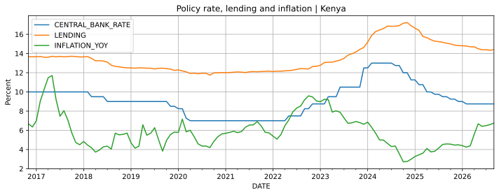
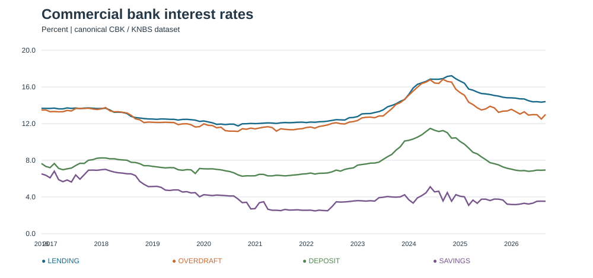
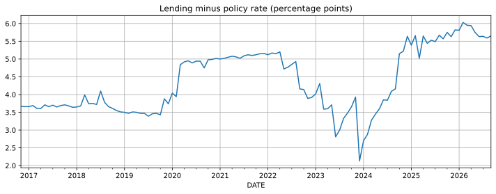
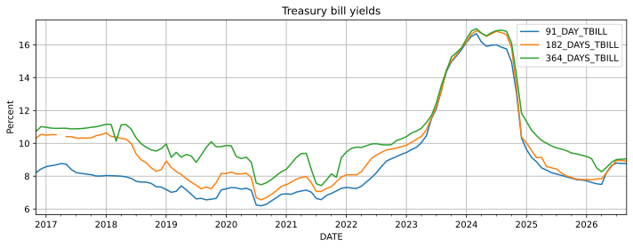
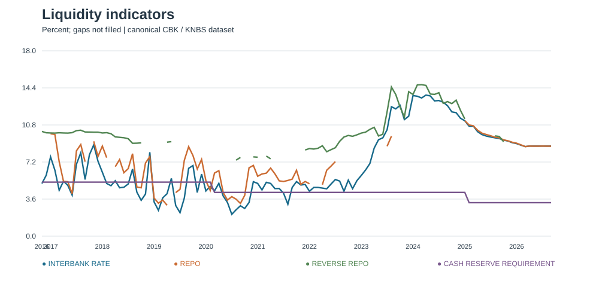
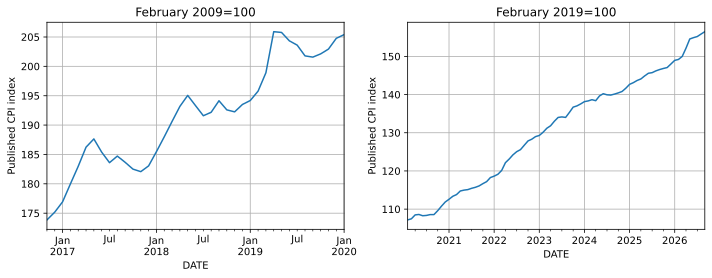

# Monetary Policy Transmission in Kenya
## Interest-rate dynamics and inflation forecasting, November 2016–September 2026

**Samuel Ndungu Njoroge** | Independent research working paper | 27 November 2026

[Dataset](data/processed/kenya_monetary_policy_audited.csv) · [Reproduction notebook](notebooks/Research_Analysis.ipynb) · [Full workflow outputs](https://github.com/samuel6183/kenya-monetary-policy-analysis/actions/runs/45920954623/artifacts/15163858210)

## Abstract

This study evaluates short-run monetary policy transmission and retrospective inflation forecast performance in Kenya using 119 consecutive monthly observations from official Central Bank of Kenya (CBK) and Kenya National Bureau of Statistics (KNBS) publications. The source-reconciled panel contains 14 numerical indicators, with 95.56% cell coverage. Dynamic regressions with heteroskedasticity and autocorrelation-consistent (HAC) covariance, stationarity tests, a reduced-form vector autoregression (VAR), and expanding-window forecasting are applied. A one-percentage-point lagged change in the Central Bank Rate (CBR) is associated with a 0.178 percentage-point change in commercial lending rates (95% CI 0.112–0.244; R² 0.489). The lending regression nevertheless fails residual autocorrelation tests. The VAR is stable but rejects residual whiteness and normality. Across 24 one-month-ahead forecasts, VAR(2) has the lowest RMSE (0.3940 percentage points), closely followed by ARIMA(1,1,0) (0.3945); AR(1) has the lowest MAE (0.2692). These results support descriptive evidence of interest-rate transmission, not causal identification or a claim of forecast superiority. The study provides a reproducible national macroeconomic baseline for further sectoral research.

**Keywords:** Kenya; monetary policy; lending rates; inflation; time series; reproducibility.

## 1. Introduction

Monetary policy affects financing conditions, purchasing power and economic decisions. In Kenya, the CBR signals policy stance, but the lending rates households and firms face also depend on bank funding costs, risk, competition, regulation and expectations. The central research problem is that movements in policy rates cannot automatically be interpreted as proportionate changes in credit costs or consumer prices. A transparent monthly analysis is needed to quantify short-run associations, assess model adequacy and benchmark inflation predictions.

### 1.1 Objectives and research questions

1. Construct and document a source-reconciled monthly macroeconomic panel. What is its coverage and where do data gaps remain?
2. Estimate short-run associations between policy-rate changes and commercial lending and inflation changes. What are the estimated magnitudes and uncertainty?
3. Assess stationarity, lag selection, stability and residual adequacy of a reduced-form VAR. Are standard model assumptions supported?
4. Compare five inflation forecasting specifications using a chronological holdout. Do more complex models improve forecast errors relative to simple baselines?

The main coefficient null hypothesis is that the lagged change in CBR has zero conditional association with lending-rate changes. This is a statistical, not a causal, hypothesis. The study is national in scope and does not estimate effects on livestock or individual households.

## 2. Literature and conceptual framework

CBK's *Modernisation of Monetary Policy Framework and Operations in Kenya* (2021) describes the interest-rate channel as a sequence from the policy signal through short-term market rates to lending conditions. Bernanke and Gertler (1995) explain how credit-market frictions may amplify monetary policy via borrower balance sheets and bank lending. The IMF's *Monetary Transmission Mechanism in the Tropics: A Narrative Approach* (2013) discusses transmission across East African economies and the importance of identifying policy actions. CBK research on transmission in Kenya also identifies the interest-rate channel as relevant in earlier samples. These studies motivate examining lending-rate adjustment, while cautioning against interpreting a reduced-form coefficient as an exogenous policy shock.

The empirical approach follows Sims (1980) in using a VAR to represent jointly evolving series, while recognizing that structural identification requires additional assumptions. Newey and West (1987) provide a covariance estimator robust to certain forms of heteroskedasticity and serial dependence. ADF and KPSS tests offer complementary evidence about unit roots and stationarity. Forecasting is treated as a distinct predictive task, using temporal ordering and baseline comparisons rather than in-sample fit. This is a targeted literature review, not a systematic review or a claim of methodological novelty.

## 3. Data and methodology

### 3.1 Design, sources and quality

The study is a quantitative retrospective longitudinal analysis of national monthly series. The sampling frame is every calendar month from November 2016 to September 2026 (119 months). CBK supplies CBR, interbank, commercial banking, Treasury bill and liquidity rates; KNBS supplies CPI and annual inflation. Collection restored the original notebook's paginated CBK data acquisition and KNBS PDF extraction. The canonical CSV has a fixed SHA-256 checksum, 119 unique months, 14 numeric indicators and a CPI base field.

| Indicator group | Coverage |
|---|---|
| CBR, lending, overdraft, deposit, savings, interbank, reserve requirement | 119 each |
| 91-day and 364-day Treasury bills | 119 each |
| 182-day Treasury bills | 118 |
| Repo / reverse repo | 87 / 78 |
| CPI / annual inflation | 119 each |

There are 74 missing numeric cells of 1,666. No imputation was used. CPI retains February 2009 and February 2019 bases; the two index levels are not spliced. Source reconciliation includes corrected inflation and deposit/savings observations. See the [audit report](docs/data-audit-2026-11-27.md) for exact reconciliation, source URLs and known discrepancies. Internal CPI consistency was checked over 95 same-base year-on-year comparisons; the audit is not independent certification.

### 3.2 Dynamic regressions

Let C_t, L_t and I_t denote CBR, weighted commercial lending rate and year-on-year inflation (percent), and let Δ denote the first monthly difference. For each outcome Y in {L,I}, the specification is:

**ΔY_t = α + β₁ ΔC_(t−1) + β₂ ΔL_(t−1) + β₃ ΔI_(t−1) + ε_t.**

OLS is used with HAC covariance (maximum lag six). Two initial observations are lost through differencing and lagging, leaving 117. Residual Ljung–Box tests at six and twelve lags assess remaining serial dependence. HAC is not a solution to omitted-variable bias or simultaneity.

### 3.3 Stationarity and VAR

ADF tests the unit-root null; KPSS tests level stationarity. Both are applied to levels and first differences. The three-variable differenced VAR uses a constant and lag-order search through six, with BIC determining the descriptive diagnostic specification. Stability is assessed via companion eigenvalues; residual whiteness and normality are separately tested. Non-orthogonal impulse responses are exploratory, not identified monetary policy shocks. Standard error bands warrant caution when diagnostics fail.

### 3.4 Forecast evaluation

The last 24 months (October 2024–September 2026) constitute a chronological holdout. At each origin, models use only earlier observations. Five fixed specifications are persistence, seasonal naive (12-month lag), AR(1), ARIMA(1,1,0), and VAR(2) on differences with predictions added to the previous inflation level. The VAR(2) predictive specification differs from the BIC-selected descriptive VAR(1). MAE and RMSE summarize errors in percentage points. This is retrospective evaluation using the currently published data vintage, not a simulation of actual release delays. No model superiority test was conducted.

## 4. Results

### 4.1 Historical dynamics



*Figure 1. CBR, commercial lending and inflation. Source: canonical CBK/KNBS panel.*

The series exhibit distinct cycles and differing adjustment speeds. Policy and lending rates need not move one-for-one. Inflation also responds to supply and external shocks omitted from this specification.



*Figure 2. Commercial lending, overdraft, deposit and savings rates.*



*Figure 3. Lending minus CBR, percentage points. This is a descriptive rate differential, not a bank net interest margin.*



*Figure 4. Treasury bill rates across three maturities.*



*Figure 5. Interbank, repo, reverse repo and reserve requirement rates. Gaps are not filled.*



*Figure 6. Published CPI levels by base. No cross-base level comparison is implied.*

### 4.2 Dynamic regression

| Lagged term | Lending change coefficient | HAC p-value | Inflation change coefficient | HAC p-value |
|---|---:|---:|---:|---:|
| Constant | 0.0053 | .5479 | 0.0072 | .9004 |
| CBR change | 0.1778 | 1.18e-7 | -0.0083 | .9635 |
| Lending change | 0.5060 | 6.80e-7 | -0.6318 | .0143 |
| Inflation change | -0.0145 | .1869 | 0.2062 | .1006 |
| R² | .4885 | | .0718 | |

Both regressions use 117 observations. The conditional lending coefficient on lagged CBR has a HAC 95% interval [0.1120, 0.2436]. This is consistent with positive short-run lending adjustment. The lending model rejects residual independence at six and twelve lags (p=.0041 and .0034). The inflation model does not reject at 5% at those lags (p=.1510 and .0566), but has low fit and the twelve-lag result is borderline. This corrects the earlier narrative which attributed significant residual autocorrelation to the inflation model. No causal conclusion follows.

### 4.3 Stationarity and VAR diagnostics

| Variable | ADF level p | ADF difference p | KPSS difference p (reported bound) |
|---|---:|---:|---:|
| CBR | .2053 | .1275 | .10 |
| Lending | .4183 | .0535 | .10 |
| Inflation | .2460 | .0040 | .10 |

The tests are mixed for CBR and lending. BIC selects VAR(1); AIC selects lag two. The fitted VAR(1) has 117 observations, maximum companion eigenvalue .6912, and is stable. Residual whiteness is rejected (p=.000531); normality is strongly rejected. Stability alone is insufficient to validate inference. The [full artifact](https://github.com/samuel6183/kenya-monetary-policy-analysis/actions/runs/45920954623/artifacts/15163858210) contains the impulse responses and correlation heatmap, together with coefficient and diagnostic tables.

### 4.4 Forecasting

| Model | MAE | RMSE |
|---|---:|---:|
| VAR(2) | .2704 | .3940 |
| ARIMA(1,1,0) | .2832 | .3945 |
| AR(1) | .2692 | .4199 |
| Persistence | .2858 | .4255 |
| Seasonal naive | 1.9171 | 2.2325 |

VAR(2) gives the lowest RMSE and AR(1) the lowest MAE. ARIMA is nearly tied with VAR on RMSE; the modest differences and short evaluation period do not establish superiority. All ARIMA fits converged. The workflow artifact contains the actual-versus-predicted chart and forecast comparison figure.

## 5. Discussion

The positive conditional CBR coefficient is consistent with an interest-rate transmission channel, but persistent lending adjustment and residual dependence suggest that one monthly lag omits dynamics. Inflation changes are poorly explained by this limited financial specification. Food and energy prices, exchange rates, fiscal developments, seasonality, policy responses and institutional changes may matter. These mechanisms are plausible explanations, not tested findings.

The VAR diagnostic failures limit confidence in impulse-response intervals. A stronger study would compare alternative lag lengths, structural-break specifications and cointegration-sensitive models, and seek defensible policy identification. The forecast experiment illustrates why a simple AR baseline should be retained: a more complex model need not improve every loss measure. Larger holdouts, real-time vintages and formal forecast comparison would strengthen predictive claims.

For agricultural and livestock research, borrowing costs and inflation provide useful national context for finance and purchasing power. Linking these indicators to farm credit, feed prices, animal-source food prices and household microdata would require a new empirical design and additional sources. This study does not establish agricultural impacts, nor is it an ILRI study or endorsement.

## 6. Conclusion

The study constructs a reproducible macroeconomic panel and finds a positive short-run conditional association between policy-rate and lending-rate changes. It does not establish a causal effect or a well-specified structural VAR. Forecasting gains over persistence are modest and metric-dependent. Future work should prioritize model adequacy, identification, sector-specific linkages and independent source checks rather than adding models for their own sake.

## References

- Bernanke, B. S., & Gertler, M. (1995). Inside the black box: The credit channel of monetary policy transmission. *Journal of Economic Perspectives, 9*(4), 27–48. https://doi.org/10.1257/jep.9.4.27
- Central Bank of Kenya. (2021). *Modernisation of monetary policy framework and operations in Kenya*. https://www.centralbank.go.ke/wp-content/uploads/2021/07/Modernisation-of-the-Monetary-Policy-Framework-Operations.pdf
- International Monetary Fund. (2013). *The monetary transmission mechanism in the tropics: A narrative approach* (Working Paper 13/197). https://www.elibrary.imf.org/view/journals/001/2013/197/article-A001-en.xml
- Dickey, D. A., & Fuller, W. A. (1979). Distribution of the estimators for autoregressive time series with a unit root. *Journal of the American Statistical Association, 74*(366), 427–431.
- Kwiatkowski, D., Phillips, P. C. B., Schmidt, P., & Shin, Y. (1992). Testing the null hypothesis of stationarity against the alternative of a unit root. *Journal of Econometrics, 54*(1–3), 159–178.
- Newey, W. K., & West, K. D. (1987). A simple, positive semi-definite, heteroskedasticity and autocorrelation consistent covariance matrix. *Econometrica, 55*(3), 703–708.
- Sims, C. A. (1980). Macroeconomics and reality. *Econometrica, 48*(1), 1–48.
- Central Bank of Kenya. (n.d.). [Interest rate statistics](https://www.centralbank.go.ke/statistics/interest-rates/) and [inflation rates](https://www.centralbank.go.ke/inflation-rates/). Retrieved 27 November 2026.
- Kenya National Bureau of Statistics. (2016–2026). *Leading economic indicators* and CPI statistical releases. [Official repository](https://repository.knbs.or.ke/); [source manifest](data/processed/cpi_source_manifest.csv).

## Appendix: reproducibility

Run from the repository root with Python 3.11 and the versions pinned in the workflow:

```bash
pip install numpy==1.26.4 pandas==2.2.3 matplotlib==3.10.0 scipy==1.15.2 statsmodels==0.14.6
python -m src.audit_dataset
python -m src.research
```

The canonical CSV is fixed by checksum. The workflow [45920954623](https://github.com/samuel6183/kenya-monetary-policy-analysis/actions/runs/45920954623) completed successfully and generated ten charts and full tables. The archived publication inputs are traceable through the audit report. Earlier preliminary results are superseded. The notebook provides a sequential reproduction interface. AI assistance was used in organizing and implementing the research; the author should independently review and understand the study before representing it as their own academic submission.
